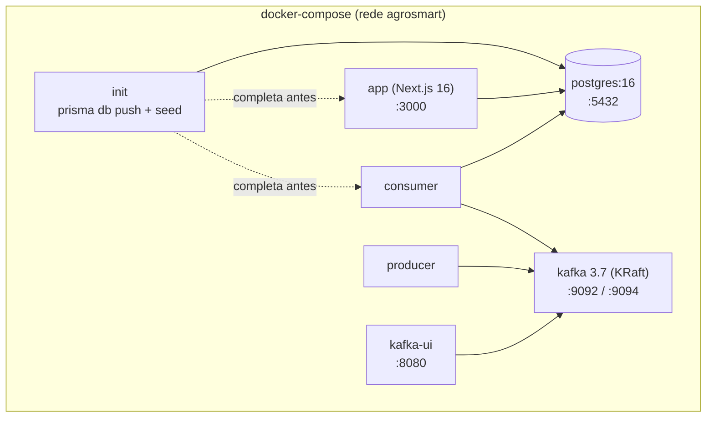

# Containerização — Arquitetura (Fase 4)

A solução AgroSmart foi empacotada em containers Docker orquestrados por um único
`docker-compose.yml` (`infra/docker-compose.yml`). Sobe o banco, o broker de
streaming, a aplicação web e o pipeline de dados.

## Diagrama de containers



## Serviços

| Serviço     | Imagem                     | Porta   | Função |
|-------------|----------------------------|---------|--------|
| `postgres`  | `postgres:16-alpine`       | 5432    | Banco de dados da aplicação (volume `pgdata`). |
| `kafka`     | `apache/kafka:3.9.0`       | 9092/9094 | Broker Kafka em modo **KRaft** (sem Zookeeper). |
| `kafka-ui`  | `provectuslabs/kafka-ui`   | 8080    | Painel web para visualizar tópicos/mensagens. |
| `init`      | build `infra/streaming`    | —       | Roda `prisma db push` + cria usuário demo, depois encerra. |
| `app`       | build `Dockerfile`         | 3000    | Aplicação Next.js (saída *standalone*). |
| `producer`  | build `infra/streaming`    | —       | Publica classificações no tópico Kafka. |
| `consumer`  | build `infra/streaming`    | —       | Consome o tópico e grava `Analysis`/`Notification`. |

## Ordem de inicialização (depends_on + healthchecks)

1. `postgres` e `kafka` sobem e ficam *healthy* (healthchecks `pg_isready` e `kafka-topics`).
2. `init` roda as migrações e o seed; ao terminar com sucesso, libera `app` e `consumer`.
3. `app`, `producer` e `consumer` sobem. O producer cria o tópico ao conectar.

## Decisões de arquitetura

- **Imagem da app em multi-stage** com `output: 'standalone'` do Next.js → runner enxuto
  (só `server.js`, `public` e `.next/static`).
- **Prisma com driver adapter (`@prisma/adapter-pg`)** → o client é gerado sem binário de
  engine, simplificando a imagem. SSL é configurável via `DATABASE_SSL` (desligado no
  Postgres local; ligado por padrão para Supabase/produção).
- **Pipeline reutiliza o mesmo schema Prisma da app** — o consumer grava nas tabelas reais
  (`Analysis`/`Notification`), então o dashboard e os alertas refletem o stream sem código
  adicional.
- **Kafka em KRaft** dispensa o Zookeeper, reduzindo um container.

## Como subir

```bash
cp infra/.env.docker.example infra/.env   # ajuste NEXTAUTH_SECRET (e GEMINI_API_KEY se quiser análise via app)
docker compose -f infra/docker-compose.yml up --build
```

| Serviço  | URL |
|----------|-----|
| App      | http://localhost:3000 |
| Kafka UI | http://localhost:8080 |

Login demo da app: `agrosmart-stream@demo.local` / `stream123`.
