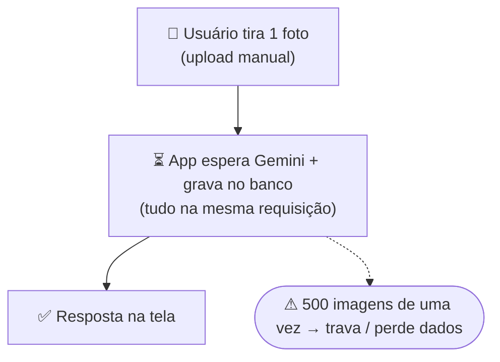
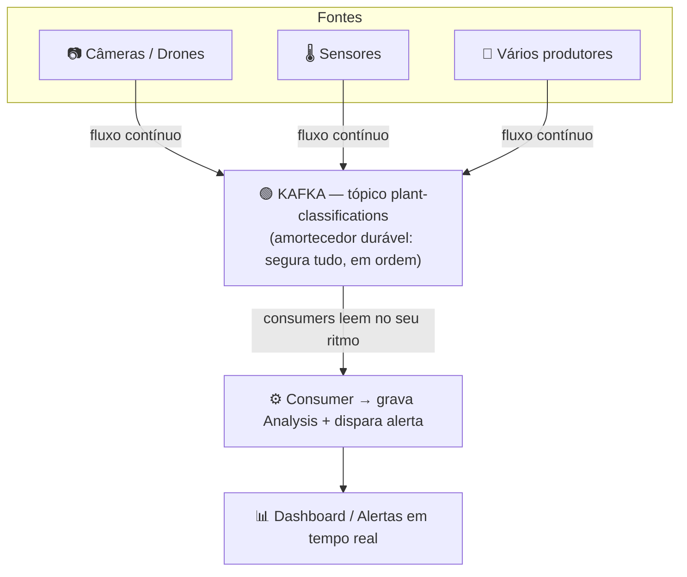

# Por que uma Pipeline de Streaming? — Antes × Depois

Material de apoio para o vídeo/apresentação do entregável 1. Mostra o contraste entre
a arquitetura atual do app (uso individual, sob demanda) e a arquitetura com pipeline
de streaming (ingestão contínua, em escala, resiliente).

> Imagem pronta para slide: [`pipeline-antes-depois.png`](./pipeline-antes-depois.png)

---

## ANTES — App atual (sob demanda)

Uma pessoa, uma foto por vez, processamento síncrono e acoplado.

**Limitações**
- ✕ **Não aguenta picos** — muitos envios simultâneos derrubam ou enfileiram tudo.
- ✕ **Frágil** — se o banco/serviço cai durante o envio, o dado se perde.
- ✕ **Não escala** — quem envia e quem processa estão grudados na mesma requisição.

---

## DEPOIS — Com pipeline (contínuo)

Muitas fontes enviando o tempo todo; quem gera e quem processa ficam desacoplados.

**Ganhos**
- ✓ **Não perde dados** — picos ficam guardados no tópico até serem processados.
- ✓ **Resiliente** — se o consumer cai, retoma do *offset* exatamente onde parou.
- ✓ **Escala independente** — mais carga? sobe mais consumers, sem mexer em quem envia.

---

## Como isso vira a simulação do projeto

| Mundo real | Na simulação |
|---|---|
| Câmeras / drones / sensores enviando dados | **producer** lê o `sample-plants.csv` em loop (1 leitura/2s) |
| O "cano" que recebe o fluxo | **Kafka** (tópico `plant-classifications`) |
| Sistema que processa e decide | **consumer** → grava `Analysis` e gera alerta se "Doente" |
| Painel de quem monitora a fazenda | **dashboard/alertas do app**, atualizando em tempo real |

O consumer grava no **mesmo Postgres do app** — por isso, com o stream rodando, o
histórico e os alertas crescem sozinhos, simulando uma fazenda enviando dados continuamente.

---

## Frase-resumo para a apresentação

> A pipeline mostra como o PlantGuard sairia de um app de **uso individual e manual**
> para uma **plataforma que ingere dados de campo continuamente, em escala, sem perder
> nada e sem travar** — o que um produto real no agronegócio precisaria.
