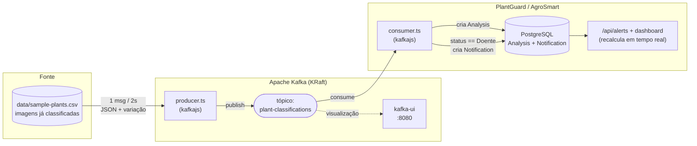

# Pipeline de Dados com Streaming — AgroSmart (Fase 4)

Simulação de **entrada contínua de imagens classificadas** trafegando por um tópico
Apache Kafka até o banco do app, disparando alertas de doença em tempo real.

## Diagrama do pipeline



## Etapas

1. **Producer** (`infra/streaming/producer.ts`) lê o `data/sample-plants.csv` em loop
   infinito, aplica uma leve variação na confiança e timestamp atual, e publica uma
   mensagem JSON por linha no tópico `plant-classifications` a cada 2s (configurável
   via `STREAM_INTERVAL_MS`).
2. **Kafka** (modo KRaft, broker único) recebe e armazena as mensagens no tópico.
   O **kafka-ui** (`http://localhost:8080`) permite visualizar as mensagens trafegando
   — usado para os prints/vídeo.
3. **Consumer** (`infra/streaming/consumer.ts`) consome o tópico e, para cada mensagem,
   cria um registro `Analysis` no PostgreSQL atrelado ao usuário demo. Quando o status
   é `Doente`, cria também uma `Notification` (`disease_alert`) — mesma lógica de
   `src/app/api/analyze/route.ts`.
4. **App**: o dashboard de analytics e a rota `/api/alerts` (`src/app/api/alerts/route.ts`)
   recalculam a partir das `Analysis`, então o fluxo aparece no app em tempo real.

## Formato da mensagem (tópico `plant-classifications`)

```json
{
  "imageName": "tomate_01.jpg",
  "status": "Doente",
  "plantType": "Tomate",
  "pathology": "Míldio",
  "confidence": 86.4,
  "description": "Lesões aquosas nas folhas inferiores...",
  "recommendations": "Aplicar fungicida à base de cobre...",
  "createdAt": "2026-06-22T21:40:00.000Z"
}
```

## Como rodar e capturar os artefatos

```bash
# Tudo via Docker (recomendado)
cp infra/.env.docker.example infra/.env   # ajuste NEXTAUTH_SECRET
docker compose -f infra/docker-compose.yml up --build
```

- **kafka-ui**: `http://localhost:8080` → cluster `agrosmart` → tópico
  `plant-classifications` → aba *Messages* (print do fluxo).
- **app**: `http://localhost:3000` → login `agrosmart-stream@demo.local` / `stream123`
  → histórico e alertas crescendo em tempo real.

Para rodar os scripts localmente (sem Docker), com Kafka/Postgres já disponíveis:

```bash
npm run stream:seed       # cria o usuário demo
npm run stream:consumer   # em um terminal
npm run stream:producer   # em outro terminal
```
