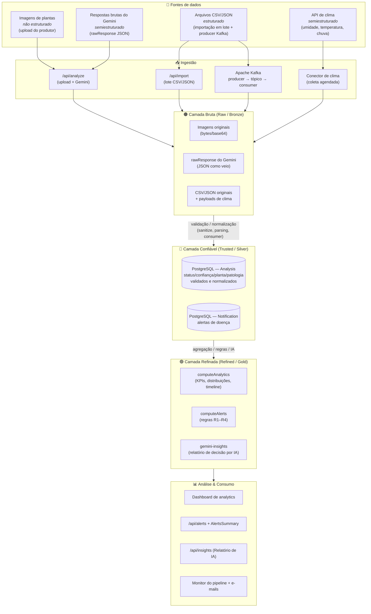

# Arquitetura de Dados com Data Lake — PlantGuard (Fase 5)

Projeto de um **Data Lake** para a solução PlantGuard, contemplando fontes e tipos de
dados heterogêneos (estruturados e não estruturados), organização em **camadas**
(bruta → confiável → refinada) e os fluxos entre **ingestão → processamento → análise**.

A arquitetura é mapeada aos componentes que o PlantGuard **já possui** (upload por imagem,
Gemini, PostgreSQL, pipeline Kafka, dashboard de analytics, alertas e o novo relatório de
IA de apoio à decisão) — não é um desenho genérico.

---

## Diagrama da arquitetura

> **PNG:** abra o arquivo [`data-lake-arquitetura.html`](./data-lake-arquitetura.html) no navegador
> e use *Salvar como imagem* / captura de tela para gerar o PNG (mesmo método da Fase 4).

---

## Função de cada camada

### 🌱 Fontes de dados
A solução combina dados **não estruturados** (imagens de plantas enviadas pelo produtor),
**estruturados** (planilhas CSV/JSON de análises e o fluxo do producer Kafka) e
**semiestruturados** (respostas JSON brutas do Gemini e payloads de API de clima). Essa
diversidade é exatamente o cenário que um Data Lake resolve melhor que um data warehouse
tradicional: armazenar primeiro, estruturar depois (*schema-on-read*).

### 📥 Ingestão
Quatro canais reais alimentam o lake:
- **Upload por imagem** (`/api/analyze`) — canal primário; a imagem vai para a IA e o
  diagnóstico é persistido.
- **Importação em lote** (`/api/import`) — CSV/JSON com análises já classificadas.
- **Streaming (Apache Kafka)** — o `producer` publica classificações no tópico
  `plant-classifications` e o `consumer` grava no banco (pipeline da Fase 4).
- **Conector de clima** — coleta agendada de uma API externa para enriquecer o contexto
  de risco de doenças.

### 🟤 Camada Bruta (Raw / Bronze)
Guarda os dados **exatamente como chegam**, sem transformação: imagens originais, o
`rawResponse` bruto do Gemini, os arquivos CSV/JSON originais e os payloads de clima.
É a "fonte da verdade" imutável — permite reprocessar tudo caso as regras de negócio mudem.
Organização recomendada: particionamento por **fonte** e por **data** (`/raw/<fonte>/<ano>/<mês>/<dia>/`).

### 🔵 Camada Confiável (Trusted / Silver)
Dados **validados, normalizados e deduplicados**. É a tabela `Analysis` (e `Notification`)
no PostgreSQL, cujo schema Prisma garante tipos e integridade: `status` restrito a
`Saudável | Doente | Inconclusivo`, `confidence` limitada a 0–100, `plantType`/`pathology`
padronizados. A transição Bruta → Confiável aplica: parsing/saneamento do JSON da IA
(`src/lib/gemini.ts`), normalização de registros importados (`sanitizeImported`) e a
gravação idempotente do `consumer` do Kafka. É a camada consultável com confiança pelo app.

### 🟢 Camada Refinada (Refined / Gold)
Produtos analíticos prontos para consumo, derivados da camada confiável:
- **`computeAnalytics`** — KPIs, distribuição por status, frequência de patologias,
  evolução temporal e saúde por cultura.
- **`computeAlerts`** — aplica as regras de decisão R1–R4 por cultura.
- **`gemini-insights`** — relatório gerencial de apoio à decisão gerado por IA a partir
  dos dados agregados (Fase 5).

### 📊 Análise & Consumo
As saídas da camada refinada abastecem o **dashboard de analytics**, os **alertas**
(`/api/alerts`), o **relatório de IA** (`/api/insights`), a **página de monitor** do
pipeline e os **e-mails** de diagnóstico/relatório.

---

## Fluxo resumido (ingestão → processamento → análise)

| Etapa | O que acontece | Componente PlantGuard |
|-------|----------------|-----------------------|
| Ingestão | Imagem/arquivo/stream/clima entram no lake | `/api/analyze`, `/api/import`, Kafka, conector de clima |
| Bruta | Dado cru é retido sem transformação | imagens, `rawResponse`, CSV/JSON, payloads de clima |
| Processamento (Raw→Trusted) | Validação, normalização, gravação | `gemini.ts`, `sanitizeImported`, `consumer.ts`, Prisma |
| Confiável | Dado padronizado e consultável | tabelas `Analysis` / `Notification` |
| Processamento (Trusted→Refined) | Agregação, regras, IA | `compute-analytics`, `compute-alerts`, `gemini-insights` |
| Refinada | Produto analítico pronto | KPIs, alertas, relatório de IA |
| Análise | Decisão e ação | dashboard, alertas, `/api/insights`, monitor, e-mails |
