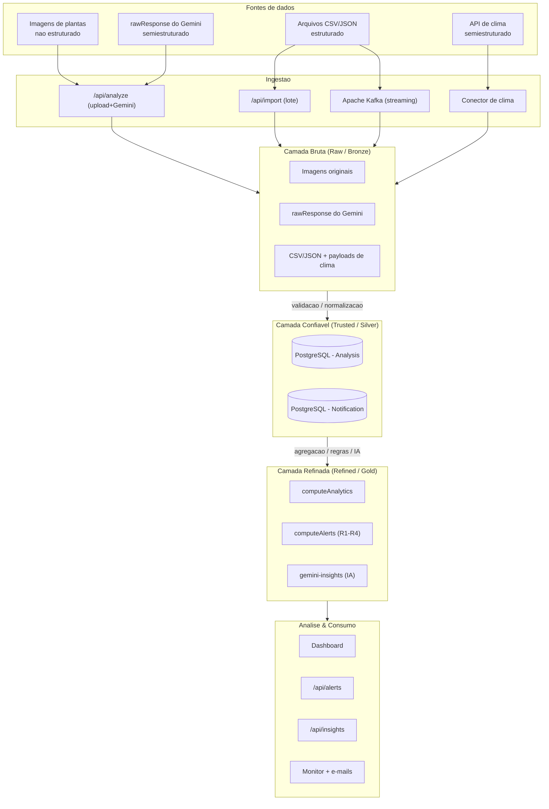
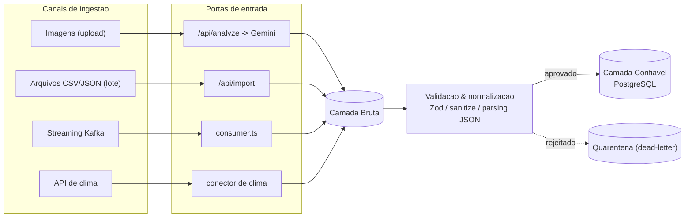
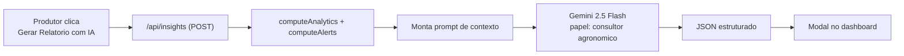

# PlantGuard — Fase 5
## Arquitetura de Dados, Ingestão, IA Generativa e Modelo de Negócio Orientado a Dados

**Solução:** PlantGuard — diagnóstico inteligente de doenças em plantas por IA.
**Desafio acadêmico:** AgroSmart (FIAP)
**Data:** 05/09/2026
**Escopo desta fase:** projetar a arquitetura de dados da solução (Data Lake), o processo de
ingestão/manutenção de dados, aplicar IA generativa como apoio à decisão (feature real no
app) e atualizar o modelo de negócio incorporando uso intensivo de dados.

> **Nota de escopo:** a solução é *vision-first* (entrada primária = imagem). **Sensores IoT
> não fazem parte do produto atual** e aparecem apenas como expansão futura no modelo de
> negócio. Os canais de dados descritos refletem o que a aplicação realmente faz: imagens,
> arquivos (CSV/JSON, em lote e streaming) e APIs (clima).

---

# 1. Arquitetura de Dados com Data Lake

O PlantGuard combina dados **estruturados** (planilhas de análises, fluxo do pipeline Kafka),
**não estruturados** (imagens de plantas) e **semiestruturados** (respostas JSON da IA,
payloads de API de clima). Esse cenário heterogêneo é organizado em um **Data Lake** com três
camadas — **bruta → confiável → refinada** — e fluxos de **ingestão → processamento → análise**.

## 1.1 Diagrama da arquitetura



> *Para o docx: inserir a imagem exportada `data-lake-arquitetura.png`.*

## 1.2 Função de cada camada

- **Fontes de dados** — imagens (não estruturado), arquivos CSV/JSON (estruturado), API de
  clima e respostas brutas do Gemini (semiestruturado). O Data Lake permite armazenar
  primeiro e estruturar depois (*schema-on-read*).
- **Ingestão** — quatro canais reais: upload por imagem (`/api/analyze`), importação em lote
  (`/api/import`), streaming (Apache Kafka) e conector de clima (coleta agendada).
- **Camada Bruta (Raw / Bronze)** — guarda o dado **como chega**, sem transformação:
  imagens originais, `rawResponse` do Gemini, CSV/JSON e payloads de clima. É a fonte da
  verdade imutável, que permite reprocessar tudo. Particionamento por fonte e data.
- **Camada Confiável (Trusted / Silver)** — dados **validados, normalizados e deduplicados**
  no PostgreSQL (tabelas `Analysis` e `Notification`), com schema versionado via Prisma:
  `status` restrito ao enum, `confidence` de 0–100, `plantType`/`pathology` padronizados.
- **Camada Refinada (Refined / Gold)** — produtos analíticos prontos: `computeAnalytics`
  (KPIs, distribuições, timeline), `computeAlerts` (regras R1–R4) e `gemini-insights`
  (relatório de decisão por IA).
- **Análise & Consumo** — dashboard, alertas, relatório de IA, monitor do pipeline e e-mails.

## 1.3 Fluxo resumido

| Etapa | O que acontece | Componente |
|-------|----------------|------------|
| Ingestão | Imagem/arquivo/stream/clima entram no lake | `/api/analyze`, `/api/import`, Kafka, conector |
| Bruta | Dado cru retido sem transformação | imagens, `rawResponse`, CSV/JSON, clima |
| Processamento (Raw→Trusted) | Validação, normalização, gravação | `gemini.ts`, `sanitizeImported`, `consumer`, Prisma |
| Confiável | Dado padronizado e consultável | `Analysis` / `Notification` |
| Processamento (Trusted→Refined) | Agregação, regras, IA | `compute-analytics`, `compute-alerts`, `gemini-insights` |
| Refinada | Produto analítico pronto | KPIs, alertas, relatório de IA |
| Análise | Decisão e ação | dashboard, alertas, `/api/insights`, monitor |

---

# 2. Processo de Ingestão, Administração e Manutenção

## 2.1 Diagrama do fluxo de ingestão



> *Para o docx: inserir a imagem exportada `ingestao-fluxo.png`.*

## 2.2 Exemplos de dados ingeridos

**CSV (lote)** — `data/sample-plants.csv`
```csv
imageName,status,plantType,pathology,confidence,description,recommendations,createdAt
tomate_01.jpg,Doente,Tomate,Míldio,86,Lesões aquosas nas folhas,Aplicar fungicida,2026-05-01
milho_02.jpg,Saudável,Milho,,94,Folhas íntegras,Manter manejo,2026-05-01
```

**JSON Lines (streaming)** — mensagem do tópico `plant-classifications`
```json
{"imageName":"tomate_01.jpg","status":"Doente","plantType":"Tomate","pathology":"Míldio","confidence":86.4,"createdAt":"2026-09-05T12:00:02Z"}
```

**JSON (imagem)** — metadados + resposta bruta do Gemini
```json
{
  "id": "ana_9f2c1a7b",
  "imagem": { "nomeArquivo": "tomate_folha_03.jpg", "tamanhoBytes": 418233, "hashSha256": "a3f5c9e1..." },
  "rawResponseGemini": { "status": "Doente", "plantType": "Tomate", "confidence": 88 }
}
```

**JSON (clima)** — payload de enriquecimento
```json
{
  "fonte": "open-meteo",
  "local": { "cidade": "Holambra", "uf": "SP" },
  "leituras": [ { "timestamp": "2026-09-05T06:00:00Z", "umidadeRelativa": 92, "temperaturaC": 18.4 } ],
  "indicadorRiscoFungico": { "nivel": "alto" }
}
```

## 2.3 Organização e manutenção

**Organização (particionamento e catálogo)**
- Camada bruta particionada por **fonte** e **data**: `raw/<canal>/<ano>/<mês>/<dia>/`.
- Camada confiável no PostgreSQL, schema versionado via **Prisma** (tipos, índices, relações).
- **Catálogo/dicionário de dados** documentado junto ao schema (enums, faixas, significados).

**Confiabilidade e qualidade**
- Validação na entrada (`Zod`, `sanitizeImported`, parsing tolerante do JSON da IA).
- Faixas e enums garantidos (`confidence` 0–100; `status` restrito).
- **Quarentena (dead-letter)** para registros inválidos, sem contaminar a camada confiável.
- **Idempotência** e *replay* a partir da camada bruta.
- **Rate limiting** nos endpoints sensíveis (inclusive `/api/insights`).

**Manutenção e governança**
- **Retenção** por idade (imagens ~90 dias; metadados/JSON ~12 meses; histórico analítico mantido).
- **Backup** do PostgreSQL (snapshots do Supabase); a camada bruta permite *rebuild*.
- **Monitoramento** em tempo real via página `/monitor` (lag do consumer, throughput, volume).
- **Segurança/LGPD**: isolamento por `userId`, segredos fora do versionamento, rotas autenticadas.

---

# 3. Inteligência Artificial Generativa para Apoio à Decisão

## 3.1 Contexto — o que já existia × o que a Fase 5 adiciona

O PlantGuard **já usava IA generativa** para diagnosticar **cada imagem** (`gemini-2.5-flash`).
A Fase 5 adiciona uma camada diferente: um **analista de IA sobre os dados agregados do
campo**. Em vez de olhar uma foto, o modelo recebe o resumo de todas as análises e produz um
**relatório gerencial de apoio à decisão** — o que priorizar, quais riscos, quais ações e a
tendência esperada.

## 3.2 Como funciona



**Componentes (código real da aplicação):**

| Arquivo | Papel |
|---------|-------|
| `src/lib/gemini-insights.ts` | Monta o prompt de consultor, chama o Gemini e sanitiza a saída. |
| `src/app/api/insights/route.ts` | Endpoint autenticado; agrega dados, rate-limit (5/h), retorna relatório. |
| `src/components/analytics/AiInsightsCard.tsx` | Botão + modal com risco, achados, prioridades, recomendações e previsão. |

**Contexto enviado ao modelo:** resumo (total, taxa de saúde, confiança média), distribuição
por status, patologias frequentes, saúde por cultura, alertas ativos (R1–R4) e evolução
temporal. O modelo roda com `temperature: 0.4` e saída em JSON, instruído a **usar apenas os
dados fornecidos**. A saída é validada (enums de risco/urgência, listas normalizadas).

## 3.3 Exemplo de saída da IA

**Entrada** (derivada de `data/sample-plants.csv`, 30 dias): Tomate 5 doente/2 saudável,
Alface 6 doente/1 saudável, "Míldio" dominante em 4 análises, Milho 8 saudável/2 doente.

**Relatório gerado** (retornado por `/api/insights`):

```json
{
  "resumoExecutivo": "No período analisado, o campo apresenta saúde geral comprometida: cerca de metade das análises indicam plantas doentes, concentradas em Alface e Tomate. O Míldio é a patologia dominante e mostra padrão de disseminação entre culturas de folha. O Milho permanece majoritariamente saudável.",
  "nivelRisco": "critico",
  "principaisAchados": [
    "Alface com taxa de doença de ~86% (6 de 7 análises) — situação de surto.",
    "Tomate com taxa de doença de ~71% (5 de 7 análises), tendência de agravamento.",
    "Míldio é a patologia mais frequente (4 ocorrências), afetando culturas de folha.",
    "Milho estável (80% saudável), sem patologia dominante."
  ],
  "prioridades": [
    { "titulo": "Conter o surto de Míldio na Alface", "acao": "Isolar canteiros afetados, remover plantas sintomáticas e aplicar fungicida específico nas próximas 48h.", "urgencia": "alta" },
    { "titulo": "Frear a progressão no Tomate", "acao": "Suspender irrigação por aspersão e iniciar manejo preventivo com fungicida à base de cobre.", "urgencia": "alta" },
    { "titulo": "Proteger o Milho", "acao": "Manter monitoramento semanal para detectar qualquer foco precoce.", "urgencia": "baixa" }
  ],
  "recomendacoes": [
    "Reduzir a umidade foliar: irrigar por gotejamento e no início da manhã.",
    "Aumentar o espaçamento/ventilação entre plantas de folha para dificultar a esporulação.",
    "Fazer rotação de culturas nos canteiros com histórico recorrente de Míldio.",
    "Ampliar a frequência de análises nas culturas em alerta para acompanhar a resposta ao tratamento."
  ],
  "previsao": "Sem intervenção nos próximos dias, o Míldio tende a se espalhar para novos canteiros de folha, elevando as perdas. Com as ações prioritárias aplicadas, espera-se estabilização e queda da taxa de doença em 2–3 semanas."
}
```

Esse JSON é exibido no modal do dashboard com selo de **Risco crítico**, cards de prioridade,
recomendações e previsão, além do rodapé com a origem dos dados e o carimbo "gerado por Gemini".

## 3.4 Resiliência
- Requer `GEMINI_API_KEY` (a mesma da análise por imagem); sem ela, retorna `503` sem quebrar o app.
- Recupera respostas truncadas por extração do maior bloco JSON válido.
- Funciona para dados próprios e para dados importados (CSV/JSON).

---

# 4. Modelo de Negócio e Inteligência de Dados

> **Objetivo desta entrega:** atualizar o modelo de negócio da solução PlantGuard,
> incorporando o uso intensivo de dados e inteligência. Devem ser considerados aspectos como:
> proposta de valor, fontes de receita, monetização baseada em dados e parcerias estratégicas.

O PlantGuard deixa de ser "um app que diagnostica fotos" e passa a ser uma **plataforma de
inteligência de dados agrícolas**: cada análise alimenta o Data Lake, que gera benchmarks,
alertas e o relatório de decisão por IA — o dado vira **ativo estratégico**.

## 4.1 Proposta de Valor (orientada a dados)
- **Da foto ao insight gerencial**: relatório de IA sobre todo o histórico do campo.
- **Detecção precoce e priorização**: alertas automáticos + IA dizem o que fazer primeiro.
- **Benchmarking**: comparação com médias regionais e por cultura (dados anonimizados).
- **Enriquecimento por clima**: antecipa janelas de risco fúngico.
- **Decisão baseada em evidência**: dashboards, tendências e histórico exportável.

## 4.2 Fontes de Receita
- **Assinatura SaaS (freemium)** — grátis com limite; planos pagos por volume e recursos.
- **Tiers de inteligência** — relatório de IA e benchmarks em planos superiores.
- **API pay-per-use (B2B)** — cobrança por análise e por chamada de insights.
- **Licenciamento multiusuário** para cooperativas e revendas.
- **Relatórios/analytics premium** — tendências por cultura/região.

## 4.3 Monetização baseada em dados
- **Benchmarks e índices regionais** (agregados e anônimos) como assinatura de inteligência.
- **Relatórios de tendência** por cultura/região para cooperativas, revendas e indústria.
- **Alertas preditivos premium** (histórico + clima) para prever surtos.
- **Data sharing B2B (opt-in)** — datasets anonimizados para fabricantes de insumos calibrarem P&D.
- **Modelos verticais treinados** a partir da base rotulada (diagnósticos + confirmações).

> **Governança:** monetização apenas sobre dados **agregados e anonimizados**, com **opt-in
> explícito** e isolamento por usuário — alinhado à LGPD.

## 4.4 Parcerias Estratégicas
- **Google AI (Gemini)** — modelo generativo (diagnóstico + relatório de decisão).
- **Cooperativas agrícolas** — distribuição, base de usuários e validação de campo.
- **Revendas de insumos** — canal de distribuição e parceria de monetização de dados.
- **Provedores de dados meteorológicos** (Open-Meteo/INMET) — enriquecimento climático.
- **Universidades e centros de pesquisa** (Embrapa, ESALQ) — validação científica e credibilidade.
- **Provedores de nuvem/infra** (Supabase/Postgres) — operação da plataforma e do Data Lake.

## 4.5 Expansão futura — sensores IoT
A solução atual é *vision-first* e **não usa sensores**. Como roadmap, sensores de campo
(umidade de solo, temperatura, molhamento foliar) são um canal de ingestão natural para o
Data Lake já projetado — adicionariam uma fonte estruturada em tempo real e reforçariam os
alertas preditivos, sem alterar as camadas. Registrado como oportunidade, não como
funcionalidade existente.

## 4.6 Resumo — evolução da Fase 4 para a Fase 5

| Eixo | Fase 4 | Fase 5 (inteligência de dados) |
|------|--------|-------------------------------|
| Proposta de valor | Diagnóstico por foto + dashboard | + Relatório de IA sobre o histórico + benchmarks + clima |
| Receita | SaaS freemium; API; licença; analytics | + Tiers de inteligência; alertas preditivos; data sharing opt-in |
| Dados | Base que cresce | **Ativo monetizável** (benchmarks, tendências, modelos) |
| Parcerias | Google AI; nuvem; coops; pesquisa | + Provedores de clima; indústria de insumos como parceira de dados |

---

# Anexos / Artefatos entregues

| Item | Artefato |
|------|----------|
| 1 — Data Lake | `docs/fase5/data-lake-arquitetura.md` + `.html` (exportar PNG) |
| 2 — Ingestão | `docs/fase5/ingestao-fluxo.md` + `.html`; amostras em `data/lake/` |
| 3 — IA Generativa | `docs/fase5/ia-generativa-decisao.md`; código: `gemini-insights.ts`, `/api/insights`, `AiInsightsCard.tsx` |
| 4 — Modelo de Negócio | `docs/fase5/modelo-negocio-dados.md` |
| Vídeo | `docs/fase5/roteiro-video.md` (roteiro do pitch de 2–3 min) |
