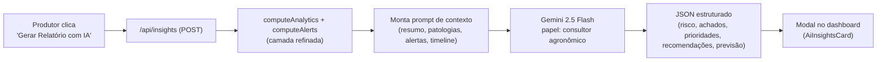

# IA Generativa para Apoio à Decisão — PlantGuard (Fase 5)

Aplicação de **IA generativa (real)** para gerar **insights, recomendações e relatórios**
a partir dos dados agregados da solução, atuando como **apoio à tomada de decisão** do
produtor rural.

---

## O que já existia × o que a Fase 5 adiciona

O PlantGuard **já usava IA generativa** — o `gemini-2.5-flash` diagnostica **cada imagem**
individualmente (`src/lib/gemini.ts`): status, patologia, confiança e recomendações por foto.

A Fase 5 adiciona uma camada diferente: um **analista de IA sobre os dados agregados do
campo**. Em vez de olhar uma foto, o modelo recebe o **resumo de todas as análises**
(distribuição de status, patologias frequentes, evolução temporal, alertas por cultura) e
produz um **relatório gerencial** — o que priorizar, quais riscos, quais ações e a
tendência esperada. É a diferença entre "esta folha está doente" e "seu tomatal está em
surto de míldio; priorize estas 3 ações esta semana".

---

## Como funciona



### Componentes (código real)
| Arquivo | Papel |
|---------|-------|
| [`src/lib/gemini-insights.ts`](../../src/lib/gemini-insights.ts) | Monta o prompt de "consultor agronômico", chama o Gemini e sanitiza o JSON de saída (`FieldInsightsReport`). |
| [`src/app/api/insights/route.ts`](../../src/app/api/insights/route.ts) | Endpoint autenticado; agrega as análises do usuário (ou dados importados), aplica rate-limit (5/h) e retorna o relatório + metadados. |
| [`src/components/analytics/AiInsightsCard.tsx`](../../src/components/analytics/AiInsightsCard.tsx) | Botão no dashboard + modal que exibe o relatório (nível de risco, achados, prioridades por urgência, recomendações, previsão). |

### Contexto enviado ao modelo
O prompt **não** manda dados crus nem imagens — manda o **agregado da camada refinada**:
- Resumo: total de análises, taxa de saúde, confiança média, nº de patologias/culturas.
- Distribuição por status (Saudável / Doente / Inconclusivo).
- Patologias mais frequentes.
- Saúde por cultura (saudável/doente/inconclusivo por planta).
- Alertas automáticos ativos (regras R1–R4, taxa de doença, patologia dominante).
- Evolução temporal (últimos registros).

O modelo roda com `temperature: 0.4` e `responseMimeType: application/json`, e é instruído
a **usar apenas os dados fornecidos** (não inventar números) e responder no schema fixo.
A saída é validada/sanitizada antes de chegar à tela (nível de risco e urgências restritos
a enums; listas normalizadas).

---

## Exemplo de saída da IA

**Contexto de entrada** (derivado de [`data/sample-plants.csv`](../../data/sample-plants.csv),
janela de 30 dias): Tomate 5 doente / 2 saudável, Alface 6 doente / 1 saudável, patologia
"Míldio" dominante em 4 análises, Milho 8 saudável / 2 doente.

**Relatório gerado** (JSON retornado por `/api/insights`):

```json
{
  "resumoExecutivo": "No período analisado, o campo apresenta saúde geral comprometida: cerca de metade das análises indicam plantas doentes, concentradas em Alface e Tomate. O Míldio é a patologia dominante e mostra padrão de disseminação entre culturas de folha. O Milho permanece majoritariamente saudável.",
  "nivelRisco": "critico",
  "principaisAchados": [
    "Alface com taxa de doença de ~86% (6 de 7 análises) — situação de surto.",
    "Tomate com taxa de doença de ~71% (5 de 7 análises), tendência de agravamento.",
    "Míldio é a patologia mais frequente (4 ocorrências), afetando culturas de folha.",
    "Milho estável (80% saudável), sem patologia dominante."
  ],
  "prioridades": [
    { "titulo": "Conter o surto de Míldio na Alface", "acao": "Isolar canteiros afetados, remover plantas sintomáticas e aplicar fungicida específico nas próximas 48h.", "urgencia": "alta" },
    { "titulo": "Frear a progressão no Tomate", "acao": "Suspender irrigação por aspersão e iniciar manejo preventivo com fungicida à base de cobre.", "urgencia": "alta" },
    { "titulo": "Proteger o Milho", "acao": "Manter monitoramento semanal para detectar qualquer foco precoce.", "urgencia": "baixa" }
  ],
  "recomendacoes": [
    "Reduzir a umidade foliar: irrigar por gotejamento e no início da manhã.",
    "Aumentar o espaçamento/ventilação entre plantas de folha para dificultar a esporulação.",
    "Fazer rotação de culturas nos canteiros com histórico recorrente de Míldio.",
    "Ampliar a frequência de análises nas culturas em alerta para acompanhar a resposta ao tratamento."
  ],
  "previsao": "Sem intervenção nos próximos dias, o Míldio tende a se espalhar para novos canteiros de folha, elevando as perdas. Com as ações prioritárias aplicadas, espera-se estabilização e queda da taxa de doença em 2–3 semanas."
}
```

Esse JSON é renderizado no modal do dashboard com o selo de **Risco crítico**, a lista de
achados, os cards de **prioridade** (com etiqueta de urgência), as recomendações e a
**previsão** — além do rodapé com a origem dos dados e o carimbo "gerado por Gemini".

---

## Requisitos e resiliência
- Requer `GEMINI_API_KEY` no ambiente (a mesma já usada na análise por imagem).
- Sem a chave, o endpoint responde `503` com mensagem clara (não quebra o dashboard).
- Respostas truncadas do modelo são recuperadas por extração do maior bloco JSON válido.
- Funciona tanto para os **dados do produtor** quanto para **dados importados** (CSV/JSON)
  em visualização no dashboard.
