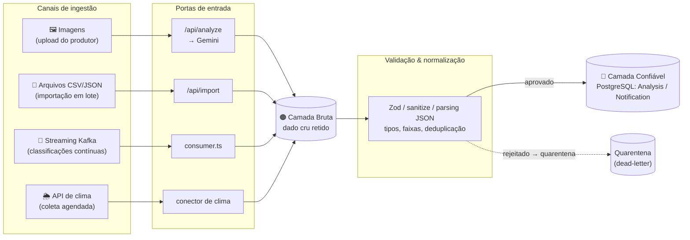

# Ingestão, Administração e Manutenção de Dados — PlantGuard (Fase 5)

Simulação do **fluxo de ingestão** de dados na solução e a **estratégia de manutenção e
confiabilidade** dos dados armazenados no Data Lake.

Os canais escolhidos refletem o que o PlantGuard realmente faz — **imagens**, **arquivos
(CSV/JSON, em lote e em streaming)** e **APIs (clima)**. Sensores IoT não fazem parte da
solução atual (é uma aplicação *vision-first*) e são tratados apenas como **expansão futura**
no [modelo de negócio](./modelo-negocio-dados.md).

---

## Diagrama do fluxo de ingestão



> **PNG:** abra [`ingestao-fluxo.html`](./ingestao-fluxo.html) no navegador e use *Baixar PNG*.

---

## Exemplos de dados ingeridos

Arquivos de amostra em [`data/lake/`](../../data/lake/) e [`data/`](../../data/):

| Canal | Tipo | Arquivo | Formato |
|-------|------|---------|---------|
| Arquivos (lote) | Estruturado | [`data/sample-plants.csv`](../../data/sample-plants.csv) | CSV |
| Streaming (Kafka) | Estruturado | [`data/lake/classificacoes-stream.jsonl`](../../data/lake/classificacoes-stream.jsonl) | JSON Lines |
| Imagem | Não estruturado + semiestruturado | [`data/lake/imagem-metadata-exemplo.json`](../../data/lake/imagem-metadata-exemplo.json) | JSON |
| API de clima | Semiestruturado | [`data/lake/api-clima-exemplo.json`](../../data/lake/api-clima-exemplo.json) | JSON |

### CSV (lote) — `data/sample-plants.csv`
```csv
imageName,status,plantType,pathology,confidence,description,recommendations,createdAt
tomate_01.jpg,Doente,Tomate,Míldio,86,Lesões aquosas nas folhas,Aplicar fungicida,2026-05-01
milho_02.jpg,Saudável,Milho,,94,Folhas íntegras,Manter manejo,2026-05-01
```

### JSON Lines (streaming) — uma mensagem por linha do tópico `plant-classifications`
```json
{"imageName":"tomate_01.jpg","status":"Doente","plantType":"Tomate","pathology":"Míldio","confidence":86.4,"createdAt":"2026-09-05T12:00:02Z"}
```

### JSON (imagem) — metadados + resposta bruta do Gemini
```json
{
  "id": "ana_9f2c1a7b",
  "imagem": { "nomeArquivo": "tomate_folha_03.jpg", "tamanhoBytes": 418233, "hashSha256": "a3f5c9e1..." },
  "rawResponseGemini": { "status": "Doente", "plantType": "Tomate", "confidence": 88 }
}
```

### JSON (clima) — payload de enriquecimento
```json
{
  "fonte": "open-meteo",
  "local": { "cidade": "Holambra", "uf": "SP" },
  "leituras": [ { "timestamp": "2026-09-05T06:00:00Z", "umidadeRelativa": 92, "temperaturaC": 18.4 } ],
  "indicadorRiscoFungico": { "nivel": "alto" }
}
```

---

## Organização e manutenção dos dados

### Organização (particionamento e catálogo)
- **Camada Bruta** particionada por **fonte** e **data**: `raw/<canal>/<ano>/<mês>/<dia>/`.
  Facilita reprocessamento e retenção seletiva.
- **Camada Confiável** no PostgreSQL, com schema versionado via **Prisma** (`prisma/schema.prisma`)
  — tipos, índices e relacionamentos garantidos.
- **Catálogo/dicionário de dados**: cada tabela e campo documentado (status ∈
  `Saudável|Doente|Inconclusivo`, `confidence` ∈ 0–100, etc.), mantido junto ao schema.

### Confiabilidade e qualidade
- **Validação na entrada**: `Zod` nos endpoints, `sanitizeImported()` na importação,
  parsing tolerante do JSON da IA (`src/lib/gemini.ts`) e normalização no `consumer`.
- **Faixas e enums**: `confidence` limitada a 0–100; `status` restrito ao enum; `plantType`
  padronizado (descarta "Não identificado" nas agregações).
- **Quarentena (dead-letter)**: registros que falham na validação não contaminam a camada
  confiável — vão para uma área de quarentena para inspeção.
- **Idempotência**: o `consumer` do Kafka pode reprocessar mensagens sem duplicar efeito
  colateral crítico; a camada bruta permite *replay* completo.
- **Rate limiting**: proteção nos endpoints sensíveis (`src/lib/rate-limit.ts`), inclusive
  no novo `/api/insights` (5 relatórios/hora por usuário).

### Manutenção e governança
- **Retenção**: camada bruta com política por idade (ex.: imagens originais 90 dias,
  metadados/JSON 12 meses); camada confiável mantida para histórico analítico.
- **Backup**: PostgreSQL com backups periódicos (o projeto usa Supabase, que oferece
  snapshots automáticos); a camada bruta é a fonte para *rebuild* das demais.
- **Monitoramento**: página `/monitor` acompanha o pipeline (lag do consumer, throughput,
  volume gravado) em tempo real.
- **Segurança/LGPD**: dados por usuário isolados por `userId`; credenciais fora do
  versionamento (`.env`); relatórios/insights só acessíveis ao dono dos dados
  (rotas autenticadas).
