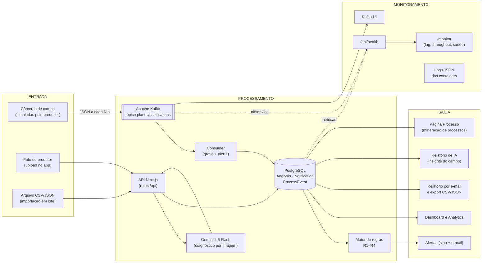
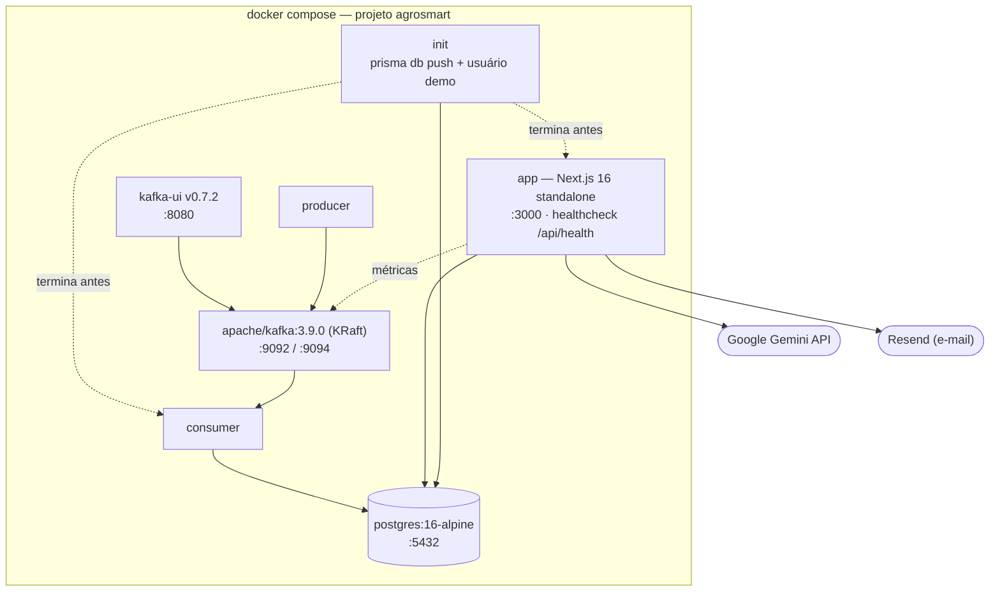
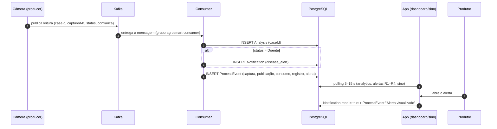
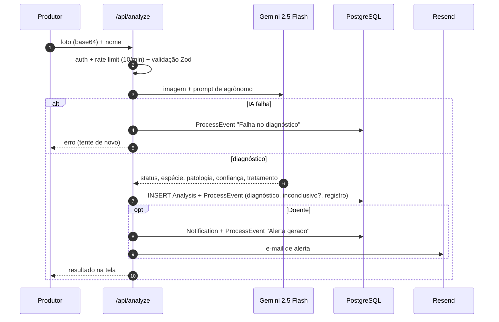
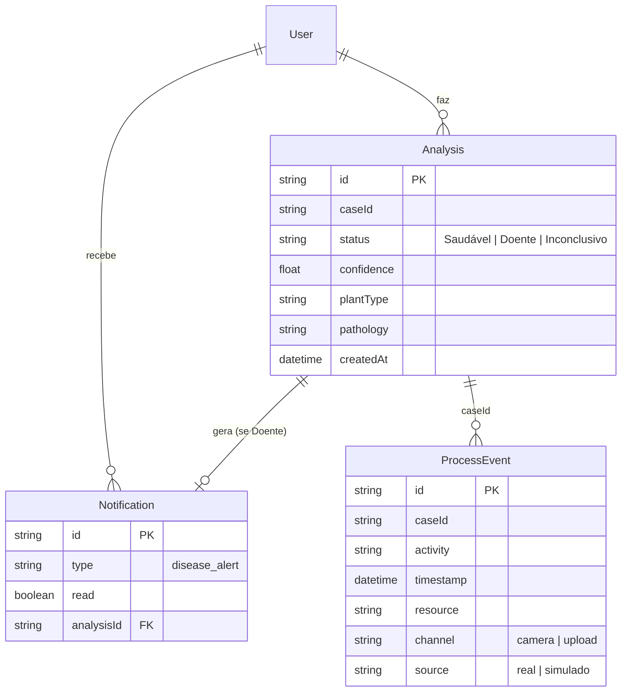

# Arquitetura final — PlantGuard (AgroSmart, Fase 7)

> Consolidação de todas as fases: diagnóstico por IA (fases 1–2), regras de decisão e alertas (fase 3),
> containers e streaming com Kafka (fase 4), dados e inteligência (fase 5) e, nesta fase,
> DevSecOps, monitoramento e mineração de processos.

## 1. Visão geral: entrada → processamento → saída



## 2. Containers (docker compose)



| Serviço | Imagem | Porta | Papel |
|---|---|---|---|
| `postgres` | `postgres:16-alpine` | 5432 | Banco único da plataforma (volume `pgdata`) |
| `kafka` | `apache/kafka:3.9.0` | 9092 / 9094 | Broker de streaming em modo KRaft (sem Zookeeper) |
| `kafka-ui` | `provectuslabs/kafka-ui:v0.7.2` | 8080 | Visualização de tópicos e mensagens |
| `init` | build `infra/streaming/Dockerfile` | — | Cria as tabelas (`prisma db push`) e o usuário demo; encerra |
| `app` | build `Dockerfile` | 3000 | Interface web + API (Next.js); roda como usuário `node`, com healthcheck |
| `producer` | build `infra/streaming/Dockerfile` | — | Simula as câmeras de campo: publica leituras classificadas no Kafka |
| `consumer` | build `infra/streaming/Dockerfile` | — | Consome o tópico, grava a análise, gera o alerta e o event log |

As duas imagens próprias rodam sem root e sem npm no runtime, e passam no Trivy sem vulnerabilidades altas ou críticas.

## 3. Componentes

| Componente | Onde está | Responsabilidade |
|---|---|---|
| Interface web | `src/app`, `src/components` | Landing, login (e-mail/senha e Google), upload, dashboard, analytics, histórico, monitor, processo, configurações |
| Autenticação | `src/lib/auth*.ts`, NextAuth v5 | Sessões JWT, OAuth Google, rotas protegidas, redefinição de senha |
| Diagnóstico por IA | `src/lib/gemini.ts`, `/api/analyze` | Gemini 2.5 Flash como "agrônomo sênior": status, espécie, patologia, confiança, tratamento |
| Relatório de IA | `src/lib/gemini-insights.ts`, `/api/insights` | Gemini analisa o conjunto de análises e devolve riscos e ações por espécie |
| Motor de regras | `src/lib/decision-rules.ts`, `compute-alerts.ts` | R1 doença detectada · R2 ≥ 50% doentes (crítico) · R3 mesma patologia ≥ 3× · R4 saudável com confiança ≤ 70% |
| Analytics | `src/lib/compute-analytics.ts`, `/api/analytics` | Taxa de saúde, distribuição, tendência, ranking de patologias |
| Ingestão em lote | `/api/import` + `validations/import.ts` | CSV/JSON validado com Zod |
| Streaming | `infra/streaming/producer.ts`, `consumer.ts` | Entrada contínua via Kafka; o consumer persiste e alerta |
| Notificações | `/api/notifications`, `NotificationBell` | Sino com alertas em tempo real; e-mail via Resend |
| Event log | `src/lib/process-log.ts`, tabela `ProcessEvent` | Registra cada etapa do caso (captura → alerta visto) |
| Mineração de processos | `src/lib/process-mining.ts`, `/process`, `analysis/process-mining` | DFG, variantes, gargalos, retrabalho; análise formal com pm4py |
| Saúde | `src/lib/health.ts`, `/api/health` | Status de app, Postgres, Kafka e lag do consumer |
| Monitor | `/monitor`, `/api/stream/monitor` | Offsets, lag, throughput, feed ao vivo, alertas e saúde, a cada 3 s |
| Pipeline DevSecOps | `.github/workflows/devsecops.yml` | Qualidade, segurança, build, teste ponta a ponta e publicação |

## 4. Fluxo de dados

### 4.1 Canal câmera (streaming)



### 4.2 Canal upload (IA)



## 5. Modelo de dados



## 6. Exemplo de entrada e saída (execução real)

**Entrada** — mensagem publicada pelo producer no tópico `plant-classifications`:

```json
{
  "caseId": "56204bcf-718f-417e-a7a1-33f8c61df72f",
  "capturedAt": "2026-11-24T19:24:56.811Z",
  "publishedAt": "2026-11-24T19:24:56.811Z",
  "imageName": "alface_03.jpg",
  "status": "Doente",
  "plantType": "Alface",
  "pathology": "Míldio",
  "confidence": 77.8,
  "description": "Manchas amarelas na face superior das folhas com esporulação cinza-roxa no verso.",
  "recommendations": "Aplicar fungicida à base de fosetil-alumínio. Aumentar aeração do canteiro."
}
```

**Processamento** — log estruturado do consumer (26 ms da publicação ao registro):

```json
{"ts":"2026-11-24T19:24:56.843Z","level":"info","service":"consumer","event":"message_persisted",
 "caseId":"56204bcf-718f-417e-a7a1-33f8c61df72f","analysisId":"cmwv33gqb001n0ins3wejc3yv",
 "status":"Doente","alert":true,"pipelineLatencyMs":26}
```

**Saída** — alerta criado para o produtor (sino do app):

```
Planta doente detectada: Alface
Míldio — 77.8% de confiança
```

e, no painel de alertas, a regra disparada por espécie (ex.: R2 "Intervenção urgente" quando ≥ 50% das análises da espécie indicam doença).

## 7. Evolução fase a fase

| Fase | O que entrou na arquitetura |
|---|---|
| 1–2 | App Next.js, upload, diagnóstico com Gemini, histórico, autenticação |
| 3 | Regras de decisão R1–R4, alertas automáticos, OAuth Google, configurações de conta |
| 4 | Docker multi-stage, docker compose, Kafka (producer/consumer), página Monitor |
| 5 | Data lake em camadas, importação CSV/JSON, analytics, relatório de IA |
| 7 | `/api/health`, painel de saúde, logs JSON, event log + mineração de processos (`/process`, pm4py), pipeline DevSecOps, containers sem root, correção de vulnerabilidades |

## 8. Decisões de arquitetura

- **Um banco, um schema** para app e streaming: o consumer grava nas mesmas tabelas, então dashboard, regras e alertas refletem o stream sem código extra.
- **Kafka desacopla a entrada**: câmeras publicam mesmo se o app estiver fora; o consumer retoma do último offset (testado derrubando o Kafka no pipeline).
- **A mensagem carrega a linhagem do caso** (`caseId`, `capturedAt`, `publishedAt`): o producer não precisa de acesso ao banco, e o event log fica completo.
- **Saúde em três níveis** (`ok`, `degraded`, `down`): com o Kafka fora o app continua atendendo uploads (HTTP 200, `degraded`); só o banco fora tira o app do ar (HTTP 503).
- **Mineração de processos dentro do produto** (página `/process`), e não só num notebook: o gestor acompanha gargalos ao vivo; o pm4py valida os mesmos números de forma independente.
